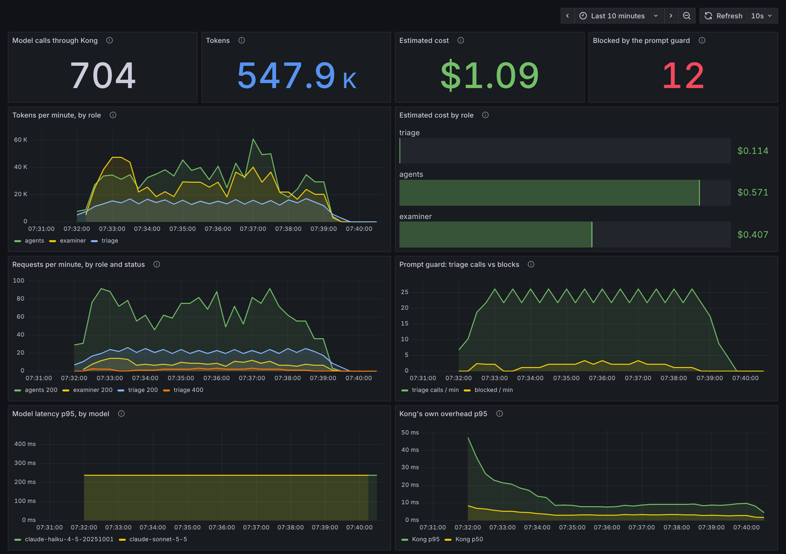

# Watchdog

> **For Kong reviewers.** Watchdog is a team hackathon project ([original repo](https://github.com/SrimanRatnapu/watchdog);
> team: snek152, lordavder, SrimanRatnapu). This copy adds Kong Gateway in front of every model call, a Kong plugin in
> Go, and a check against the real Anthropic API. That part is my own work (Sriman Ratnapu, October 2026), written with
> Claude Code. Start with [what I learned about Kong](#what-i-learned-about-kong-312) and the
> [limitations](#limitations), then [docs/kong.md](docs/kong.md).

Wildlife traffickers rarely write "ivory". They write "old bone carving", "mammoth-style", "vintage piano key". Keyword filters miss it.

Watchdog reads flagged marketplace listings the way an investigator would. Specialists check the price, seller, photos and wording. Then three AI agents with opposing goals argue over the evidence, and every claim has to cite a source:

- **Undercover** looks for red flags.
- **Counsel** looks for innocent explanations.
- **Case officer** compares against past cases.

They end on one of four outcomes: likely illegal, contested, watching, or dismissed. Each comes with a case file.

**1st place, Cisco track (When AI Agents Disagree), UCSC AI Hackathon.**

[Demo video](https://youtu.be/Vn_vT54s7Kw)

## This fork: Watchdog behind Kong Gateway

Watchdog was built as a team at the hackathon (commits by snek152, lordavder and SrimanRatnapu in this history). This
fork, by Sriman Ratnapu, adds [Kong Gateway](https://konghq.com/products/kong-gateway) in front of every model call:

- **One gateway for all model traffic.** Triage, the three agents, the photo examiner and translation each get their own
  Kong consumer and key. Kong holds the real Anthropic key and reports tokens per role and model on Prometheus, one
  view of model use across all of Watchdog's processes.
- **Prompt guard as a red flag.** Kong's `ai-prompt-guard` checks the seller's text at triage. A listing that tries to
  instruct the AI is blocked before any model sees it, and Watchdog flags it with score 1.0.
- **A Kong plugin in Go: `watchdog-audit`.** Every model call is written to a hash chain with its role, case, model and
  request/response hashes. A later edit to an entry breaks the chain, so the AI calls behind a case can be checked
  (`scripts/verify_audit_chain.py`).
- **Grafana dashboard.** Tokens, estimated cost, guard blocks and latency per role, from Kong's Prometheus metrics.

Two kinds of measurement, kept apart:

- **Guard eval: real Kong 3.12, offline stand-in for the Anthropic API** (`infra/kong/mock_anthropic.py`, no key, no
  cost). The guard blocked 13 of 26 red-team attacks (all direct, role-play and buried ones; no paraphrased or
  non-English ones), 0 of 12 benign look-alikes, and 1 of 510 stored listings (the team's own injection test).
- **End-to-end check: real Kong 3.12, real Anthropic API.** 83 model calls (6 listings through the full pipeline,
  plus the demo script and one smoke test), 0 errors, audit chain verified, Kong's per-role token counts equal to
  Anthropic's uncached input and output tokens. Cost $1.24. This shows the plumbing works; 6 listings say nothing about
  accuracy.

### What I learned about Kong (3.12)

- **No Anthropic request format.** `ai-proxy`'s `llm_format` in 3.12 accepts openai, bedrock, gemini, cohere and
  huggingface. Converting Watchdog's calls to OpenAI's format would lose tools, images, thinking and prompt caching, so
  I used `route_type: preserve`, which is deprecated since 3.10 and passes the body through unchanged.
- **Cached tokens were not counted.** On the real API, Kong's token metrics matched Anthropic's `input_tokens` and
  `output_tokens` exactly, but left out prompt-cache reads and writes. A cost computed from them came out about 7% low
  ($1.16 against $1.24 billed).
- **A regex guard has a ceiling.** `ai-prompt-guard` caught all direct, role-play and buried attacks and no paraphrased or
  non-English one.
  That is a limit of matching patterns, not of tuning; `ai-semantic-prompt-guard` (Enterprise) is Kong's answer.
- **Newer Kong closes the first two.** Checked in the images: 3.13 adds `anthropic` to `llm_format`, and 3.14 counts
  Anthropic's cache tokens in `prompt_tokens`. The next step for this project is to upgrade and move off `preserve`
  (not done or tested yet).
- **Kong itself was cheap.** It added 5 ms or less at the median on real traffic. The model calls averaged 1 to 8 seconds.

### Limitations

- `preserve` mode means Kong proxies, authenticates, meters and guards, but does not translate or route between models.
- Rate limits count requests per role, not tokens (token limits need `ai-rate-limiting-advanced`, Enterprise).
- The Go plugin runs as an external plugin server, so each request makes RPC calls to it, and reading the response body
  makes Kong buffer the whole response: no streaming through this route.
- The audit chain shows any entry edited without recomputing the hashes after it. It is not signed or published
  anywhere, so someone with write access could rewrite the whole file. One file, one Kong node.
- "Blocked" in the audit log is inferred: a 400 that Kong produced itself, not the upstream.

Details and design choices: [docs/kong.md](docs/kong.md). Quick start, offline with no API key: `make kong-dash`, then
`DL_GATEWAY_URL=http://localhost:8010` in `.env`, then `make kong-demo` for a guided walkthrough and
http://localhost:3001 for the dashboard.



## Run it

```
cp .env.example .env     # add ANTHROPIC_API_KEY
cd backend && uv run uvicorn deadlang.api.server:app --port 8000
cd frontend && npm install && npm run dev
```

Open http://localhost:3000. To send the model calls through Kong instead, start Kong (`make kong` with
`ANTHROPIC_API_KEY` set, or `make kong-mock` offline) and set `DL_GATEWAY_URL=http://localhost:8010` in `.env`; Watchdog
then needs only the gateway keys that `infra/kong/render.py` writes there. Backend tests: `cd backend && uv run pytest -q -m "not integration"`.
